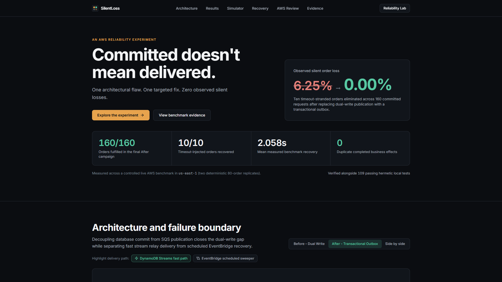
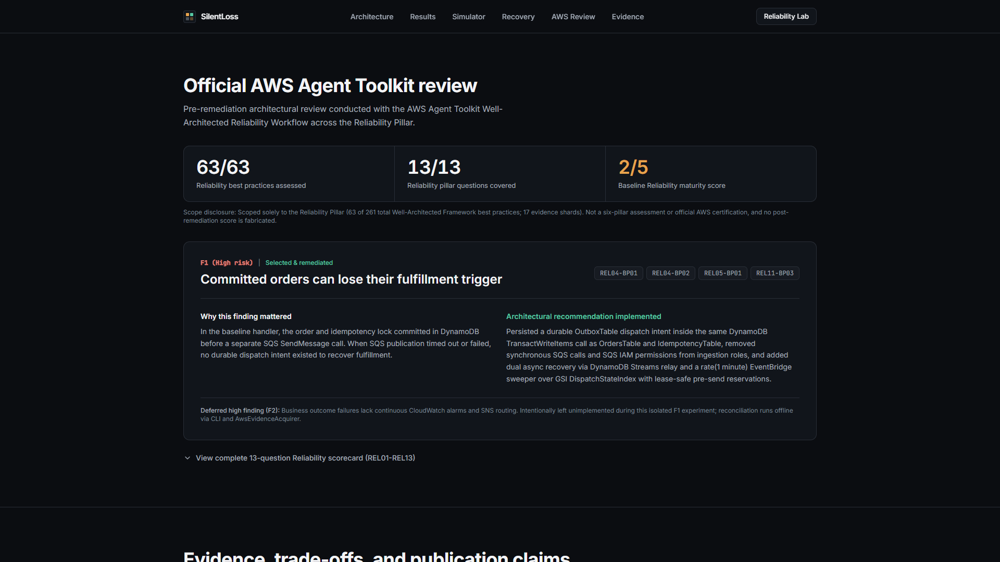
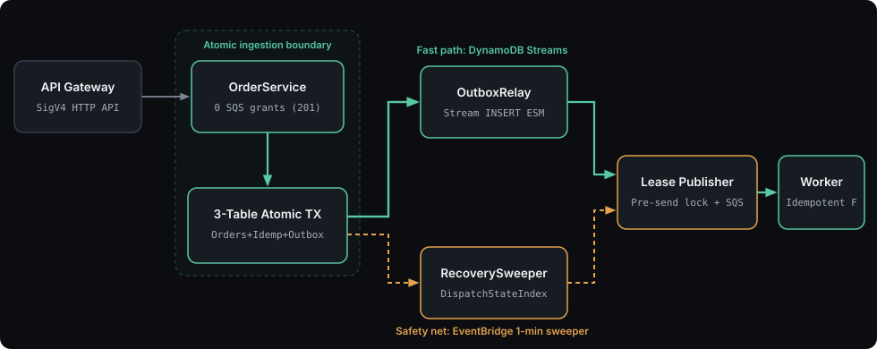
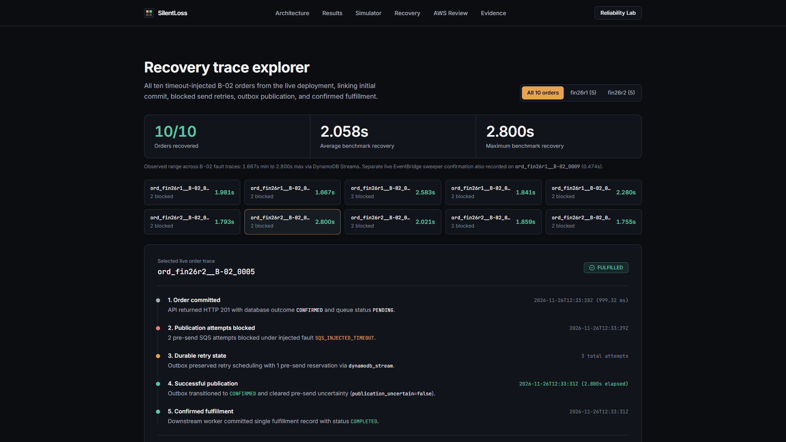
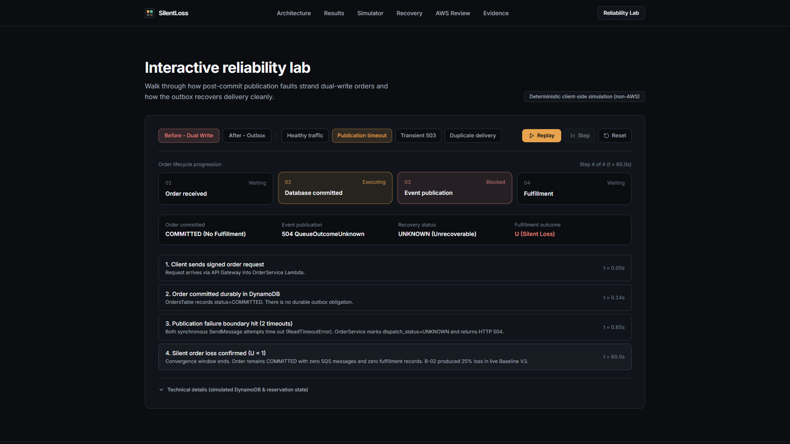
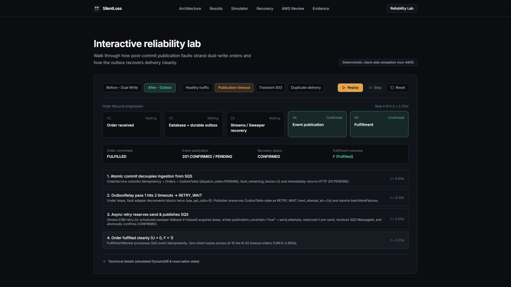
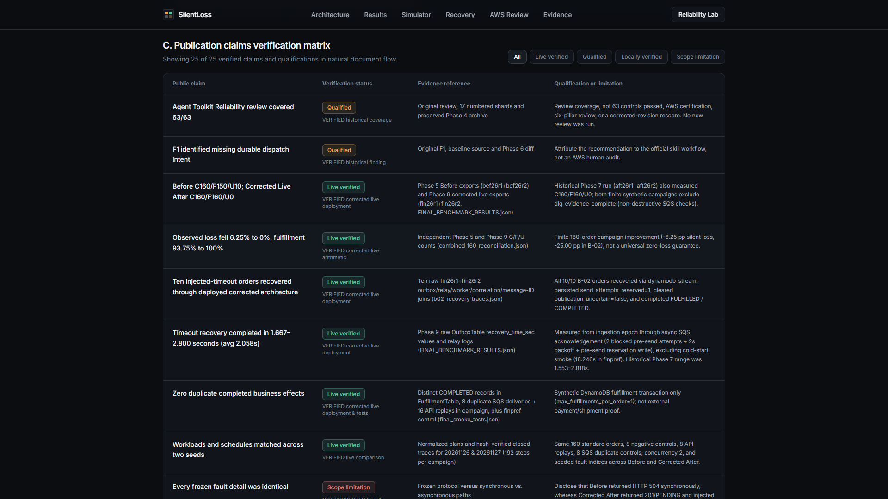

# SilentLoss

**Committed doesn't mean delivered.**  
An AWS reliability engineering experiment exposing silent post-commit publication loss in serverless systems and eliminating observed losses using a transactional outbox pattern.

**Live Interactive Dashboard:** [https://mdzubair933.github.io/silentloss/](https://mdzubair933.github.io/silentloss/)

[](docs/assets/screenshots/01-hero-overview.png)

### Core Claims & Verified Findings

- **Silent Loss Eliminated (6.25% → 0.00%):** Overall silent loss dropped from 6.25% (10/160) to 0.00% (0/160) across 160 live committed AWS orders, eliminating the 25.00% (10/40) loss in timeout scenario `B-02`.
- **160/160 Final Delivered Orders ($C = F$):** 100% fulfillment completion rate achieved under identical deterministic workloads without manual operator intervention ($C = F + P + E + U + I$ with $F=160, U=0$).
- **10/10 Timeout Faults Recovered:** All 10 timeout-injected orders were automatically recovered asynchronously in 1.667s–2.800s (mean 2.058s) via DynamoDB Streams relay and scheduled sweeper.
- **Zero Duplicate Completed Business Effects ($D = 0$):** Strictly zero double-fulfillments across all scenarios despite at-least-once queue redelivery.
- **Official AWS Agent Toolkit Reliability Review:** Scoped assessment covering 63/63 in-scope Reliability Best Practices and 13/13 questions (`REL01`–`REL13`), identifying high-risk finding `F1` as the architectural target.
- **Empirical Boundaries & Scope:** Clearly distinguishes live AWS empirical findings (160-order live campaign in `us-east-1`) from offline local hermetic tests (109 unit/reconciliation tests) and controlled application-layer fault adapters (`SQS_INJECTED_TIMEOUT`, `SQS_INJECTED_503`).

---

## 1. Problem Statement & Background

Modern distributed applications frequently persist state to a primary database (`DynamoDB`) and then synchronously publish an integration event (`Amazon SQS`) inside the same request handler:

1. The database transaction commits (`OrdersTable` transitions to `COMMITTED`).
2. The downstream `sqs:SendMessage` call times out or fails (`HTTP 504` / transient `503`).
3. Because no durable publication intent was persisted alongside the order, no async worker or queue retry ever learns the order existed.

SilentLoss quantifies this failure mode using a mutually exclusive accounting invariant over unique committed order IDs ($C$):

$$C = F + P + E + U + I$$

| Symbol | Classification |
|---|---|
| **$C$** | Unique committed orders persisted durably in `OrdersTable` |
| **$F$** | Fulfilled orders (`FulfillmentTable` `COMPLETED` + `OrdersTable` `FULFILLED`) |
| **$P$** | Durably recoverable pending orders with intact `OutboxTable` obligation |
| **$E$** | Explicitly failed orders settled to a documented terminal state |
| **$U$** | Unaccounted committed orders (**confirmed silent loss**) |
| **$I$** | Indeterminate orders (inconclusive telemetry or ambiguous state) |
| **$D$** | Duplicate completed business effects across unique committed orders |

---

## 2. Official AWS Agent Toolkit Review & Finding `F1`

Prior to remediation, the baseline workload underwent a structured architectural review scoped to the **AWS Well-Architected Reliability Pillar** using the AWS Agent Toolkit Well-Architected Review workflow:

- **Coverage:** **63 / 63** in-scope Reliability Best Practices read and assessed across **13 / 13** Reliability questions (`REL01`–`REL13`; `17` evidence shards).
- **Baseline Reliability Maturity:** **2 / 5** (`0` Critical, `2` High, `9` Medium findings).
- **Scope Qualification:** This assessment covers only the Reliability Pillar (`63` of `261` Framework Best Practices). It is not a six-pillar review or an official AWS certification/endorsement, and no post-remediation score was fabricated.

### Selected High-Risk Finding (`F1`)

> **F1 (High Risk): Committed orders can lose their fulfillment trigger.**  
> **AWS Best Practices:** `REL04-BP01`, `REL04-BP02`, `REL05-BP01`, `REL11-BP03`

The review recommended atomically persisting a durable dispatch intent alongside the business order and decoupling asynchronous event publication into a recoverable delivery pipeline. A second High finding (`F2` — continuous CloudWatch alarms and SNS alerting) was explicitly deferred out of scope for this isolated `F1` remediation experiment.



---

## 3. Before & After Architecture

| Before — Dual Write (`U = 10`) | After — Transactional Outbox (`U = 0`) |
|---|---|
|  |  |


### Transactional Outbox Implementation (`src/lambdas/` + `template.yaml`)

1. **Atomic 3-Table Ingestion Commit (`OrderService`):** Commits `OrdersTable` (`COMMITTED`), `IdempotencyTable`, and `OutboxTable` (`dispatch_state = PENDING`, deterministic UUIDv5 `event_id`) inside one `DynamoDB TransactWriteItems` transaction and returns `HTTP 201 CONFIRMED / PENDING`. Ingestion IAM roles (`OrderServiceRole`, `ExperimentServiceRole`) hold **zero `sqs:*` permissions**.
2. **Fast Path (`OutboxRelay` Lambda):** Subscribes to `OutboxTable` `DynamoDB Streams` (`INSERT` filter, `BatchSize = 5`, `MaximumRetryAttempts = 2`, `ReportBatchItemFailures`).
3. **Scheduled Recovery Safety Net (`OutboxRecoverySweeper`):** EventBridge `rate(1 minute)` rule scans `DispatchStateIndex` GSI for stalled `PENDING`, due `RETRY_WAIT`, or expired `10s` `PUBLISHING` leases.
4. **Lease-Protected Pre-Send Uncertainty Reservation (`common/outbox.py`):** Before invoking `sqs:SendMessage`, the publisher acquires a conditional lease lock, writes `publication_uncertain = "true"`, and increments `send_attempts_reserved` inside DynamoDB. Only an atomic `CONFIRMED` commit clears `publication_uncertain`. If uncertainty persists when the retry budget exhausts (default `25`), the record halts safely in `UNKNOWN` for manual operator inspection rather than looping indefinitely or falsely marking failed.
5. **Duplicate-Resistant Fulfillment (`FulfillmentWorker`):** Conditional DynamoDB writes enforce `attribute_not_exists(order_id)` so at-least-once SQS deliveries yield `D = 0` duplicate completed business effects.

---

## 4. Benchmark Methodology & Measured Live AWS Results

Both architectures were benchmarked in `us-east-1` (ARM64 Python 3.14 Lambdas) across identical deterministic PRNG seeds (`20261126` and `20261127`), concurrency (`2`), worker concurrency (`2`), and fault injection rates (`25%` timeout injection in `B-02`, `20%` transient `503` injection in `B-03`, API replays + injected SQS duplicates in `B-04`).

| Metric | Before (`silentloss-baseline-exp`) | Corrected Live After (`silentloss-remediated-exp`) | Delta |
|---|---:|---:|---:|
| **Unique Committed Orders ($C$)** | 160 | **160** | `0` |
| **Fulfilled Orders ($F$)** | 150 | **160** | **`+10`** |
| **Durably Pending ($P$) / Failed ($E$) / Indeterminate ($I$)** | `0 / 0 / 0` | **`0 / 0 / 0`** | `0` |
| **Confirmed Silent Loss ($U$)** | **10** | **0** | **`-10`** |
| **Overall Silent Loss Rate ($U / C$)** | **6.25%** | **0.00%** | **`-6.25 pp`** |
| **`B-02` Timeout Scenario Loss Rate** | **25.00%** (`10/40`) | **0.00%** (`0/40`) | **`-25.00 pp`** |
| **Fulfillment Completion Rate ($F / C$)** | **93.75%** | **100.00%** | **`+6.25 pp`** |
| **Duplicate Completed Business Effects ($D$)** | `0` | **`0`** | `0` |
| **`B-02` Warm Timeout Recovery Time (Min / Avg / Max)** | Unrecovered ($\infty$) | **`1.667s / 2.058s / 2.800s`** | **`10/10` recovered** |
| **Ingestion Lambda Duration (Avg / p95)** | `71.28 ms / 98.85 ms` | **`37.88 ms / 43.91 ms`** | **`-46.9%` avg** |
| **Client Standard HTTP RTT (Avg)** | `951.67 ms` | `965.32 ms` | `+13.65 ms` (flat) |
| **Estimated Gross Window Spend (before Free Tier)** | `$0.002112` USD | **`$0.002901` USD** | **`+$0.000789` USD** |


### Recovery Evidence & Live Sweeper Confirmation

- **All `10/10` `B-02` Timeout Orders (`fin26r1` + `fin26r2`):** Each order blocked `2` pre-send attempts (`sqs_api_calls = 0` on initial pass), recorded `send_attempts_reserved = 1`, recovered asynchronously via `dynamodb_stream` in `1.667s`–`2.800s` (mean `2.058s`), cleared `publication_uncertain = false`, and converged cleanly to `FULFILLED` / `COMPLETED` (`data/b02_recovery_traces.json`).
- **Live Scheduled Sweeper Execution:** Healthy `PENDING` order `ord_fin26r1__B-02_0009` coincided with the scheduled `OutboxRecoverySweeper` tick and confirmed cleanly in **`0.474s`** (`trigger_source = scheduled_sweeper`, `errors = 0`, zero duplicates). Intentional missed-stream and expired-lease crash failover remain verified hermetically in unit tests (`tests/unit/test_f1_outbox.py`).



---

## 5. Interactive Web Dashboard & Failure Lab

The repository includes a static, read-only React + TypeScript dashboard under `frontend/` built on curated publication-safe exports (zero AWS credentials, API hostnames, or live mutating controls):

| Before Simulation (`U = Silent Loss`) | After Simulation (`F = Fulfilled`) |
|---|---|
|  |  |



---

## 6. Performance, Cost Trade-offs & Material Limitations

- **Ingestion Latency vs. Client RTT:** Removing synchronous `sqs:SendMessage` from `OrderService` cut server ingestion duration by `46.9%` (`71.28 ms` -> `37.88 ms`), while end-to-end API Gateway client RTT stayed essentially flat (`951.67 ms` -> `965.32 ms`). Wall-clock campaign reduction (`484s` -> `138.033s`) reflects eliminating `60s` stalls waiting on stranded `B-02` orders, not a general throughput multiplier.
- **Metered Gross Cost Increase:** Adding `OutboxTable` transactional/reservation WCUs (`3,128` vs. `1,432`), stream polling, and `rate(1 minute)` sweeper scans raised modeled pre-Free-Tier window spend from `$0.002112` to `$0.002901` USD.
- **Controlled Application-Layer Faults:** `SQS_INJECTED_TIMEOUT` and `SQS_INJECTED_503` simulate pre-send errors inside an isolated benchmark fault adapter; they do not simulate live AWS SQS or DynamoDB regional outages.
- **Synthetic Business Effect:** Verified `D = 0` idempotency governs synthetic DynamoDB `FulfillmentTable` writes, not external payment or carrier APIs.
- **Non-Destructive Queue Inspection:** `AwsEvidenceAcquirer` uses read-only `GetQueueAttributes` without polling active queues (`83.33%` source completeness; DLQ body inspection excluded intentionally).
- **Finite Benchmark vs. Universal Guarantee:** Observed `0.00%` silent loss reflects two deterministic `80`-order replicates (`160` orders). When retry budgets exhaust with `publication_uncertain = true`, records deliberately halt in `UNKNOWN` (`I`) for operator resolution.
- **Cold-Start Smoke vs. Warm Campaign:** First-invocation ARM64 cold starts during `finpref` post-deploy smoke testing recorded `15.906s`–`19.278s` recovery vs. `1.667s`–`2.800s` under warm campaign runs.
- **Hermetic Edge Failures:** Cross-invocation lost-ack `AccessDenied`, interrupted reservation writes, terminal transaction readback failure (`TERMINAL_STATE_UNVERIFIED`), and missed-stream/expired-lease crash failover are proven exclusively in the **109-test hermetic local suite** (`tests/unit/`).

---

## 7. Setup, Verification & Reproduction

### Local Hermetic Test Suite (`109` Python tests + `5` Frontend tests)

```bash
# Python backend & reconciliation verification (hermetic, offline)
python -m venv .venv
source .venv/bin/activate  # Windows: .venv\Scripts\activate
pip install -r requirements.txt -r requirements-dev.txt
python scripts/hermetic_pytest.py
python scripts/scan_privacy.py
```

```bash
# Frontend TypeScript check, Vitest suite & Vite production build
cd frontend
npm ci
npm test
npm run build
npm run preview   # http://127.0.0.1:4173/
```

### Benchmark Harness Dry-Run & Live Stack Deployment

```bash
# Validate deterministic 80-order scenario plan without AWS calls
python scripts/run_benchmark.py --scenario ALL --seed 20261126 --dry-run

# Build & deploy the remediated SAM stack (requires AWS credentials & SAM CLI)
sam build --template-file template.yaml --use-container
sam deploy --guided
```

---

## License

All rights reserved pending repository license selection by the project owner.
