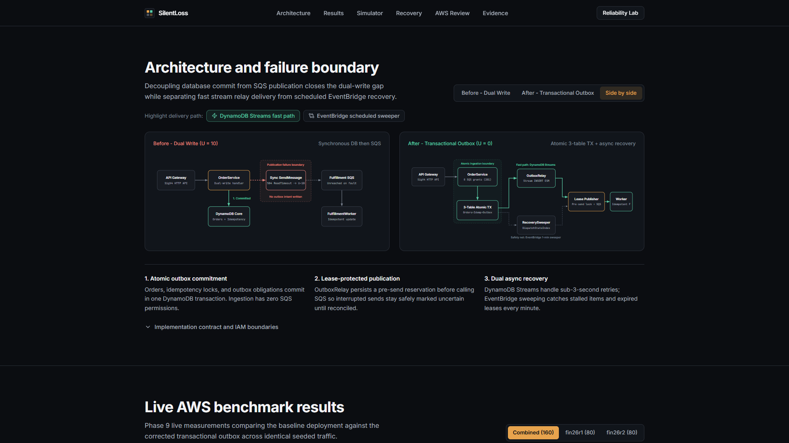
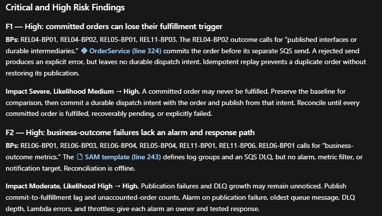
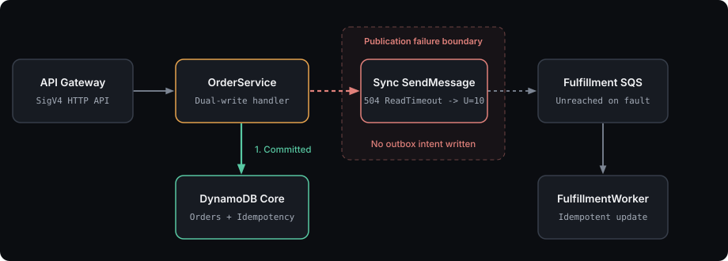
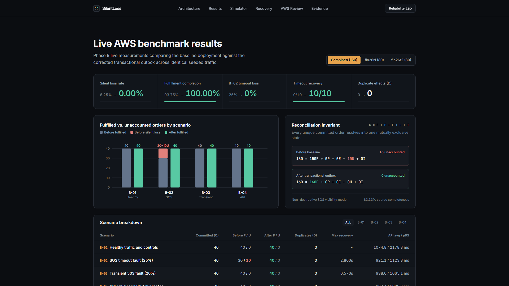

<div align="center">

# SilentLoss

**Committed doesn't mean delivered.**

An evidence-driven AWS reliability experiment that transforms agent-led architectural guidance into measurable distributed-system reliability improvement.

**[Explore Live Dashboard](https://mdzubair933.github.io/silentloss/)** &nbsp;&middot;&nbsp; **[Watch Technical Demo](https://mdzubair933.github.io/silentloss/demo-video.html)** &nbsp;&middot;&nbsp; **[Explore Source & Evidence](#repository-structure)**

<br />

<a href="https://mdzubair933.github.io/silentloss/">
  
</a>

</div>

---

## Measured Impact

| Observed silent loss | Orders fulfilled | Timeout orders recovered | Duplicate business effects |
|---|---|---|---|
| **6.25% &rarr; 0.00%** | **160/160** | **10/10** | **0** |

- **63/63** Reliability best practices assessed during pre-remediation review.
- **109** hermetic regression tests passed for the corrected revision.
- **2.058 seconds** mean measured benchmark recovery time across timeout faults.
- **46.9%** reduction in average ingestion Lambda duration (`71.28 ms` &rarr; `37.88 ms`).

> Results from controlled live AWS benchmarks with `160` committed orders per campaign, using matched deterministic workloads and application-layer fault injection.

---

## Navigation

[See SilentLoss in Action](#see-silentloss-in-action) &middot; [The Problem](#the-problem--when-committed-doesnt-mean-delivered) &middot; [Agent Toolkit Finding](#what-the-aws-agent-toolkit-found) &middot; [Architecture](#one-architectural-change) &middot; [Benchmark Results](#live-aws-benchmark-results) &middot; [Deliverables](#what-silentloss-delivers) &middot; [Reliability Lab](#interactive-reliability-lab) &middot; [Edge Verification](#engineering-beyond-the-happy-path) &middot; [Trade-offs & Limits](#performance-cost-and-limitations) &middot; [Repository](#repository-structure) &middot; [Reproduce](#reproduce-the-experiment)

---

## See SilentLoss in Action

Watch the technical walkthrough covering the original failure, the Agent Toolkit finding, the transactional outbox remediation, and the measured live AWS results.

<p align="center">
  <a href="https://mdzubair933.github.io/silentloss/demo-video.html">
    
  </a>
</p>

<p align="center">
  <strong><a href="https://mdzubair933.github.io/silentloss/demo-video.html">Watch Technical Demo (02:50)</a></strong>
  &nbsp;&nbsp;|&nbsp;&nbsp;
  <a href="https://youtu.be/awVoBcu6k2A">Watch on YouTube</a>
  &nbsp;&nbsp;|&nbsp;&nbsp;
  <a href="https://mdzubair933.github.io/silentloss/">Open Live Reliability Lab</a>
</p>

---

## The Problem &mdash; When Committed Doesn't Mean Delivered

Consider a customer placing an order through a typical serverless API (`API Gateway` &rarr; `OrderService` Lambda):

1. The handler writes the order to `DynamoDB` (`OrdersTable`) and succeeds. The system of record now shows the order as **committed**.
2. Next, in the same request handler, it makes a separate synchronous `sqs:SendMessage` call to `Amazon SQS` so downstream fulfillment can process it.
3. If that SQS publish call times out or fails after the database transaction has already committed, no message enters the queue.

From the business perspective, the customer's order sits in DynamoDB indefinitely without triggering warehouse dispatch or shipping. Even if the client retries with the same idempotency key, standard API idempotency returns the previously recorded database outcome (`COMMITTED`) without re-attempting the missing SQS publish. The failure stays silent unless an explicit reconciliation audit inspects both sides of the commit boundary.

---

## What the AWS Agent Toolkit Found

Before modifying any application code, the baseline system (`silentloss-baseline`) underwent a structured architectural review using the **AWS Agent Toolkit Well-Architected Review** workflow scoped exclusively to the **AWS Well-Architected Reliability Pillar**:

- **Assessment Scope:** Reliability Pillar only (`63 / 63` in-scope best practices assessed across `13 / 13` Reliability questions, `REL01`&ndash;`REL13`, backed by `17` evidence shards).
- **Baseline Reliability Maturity:** **`2 / 5`** (`0` Critical, `2` High, `9` Medium findings).
- **Selected High-Risk Finding (`F1`):** ***Committed orders can lose their fulfillment trigger*** (`REL04-BP01`, `REL04-BP02`, `REL05-BP01`, `REL11-BP03`).

<p align="center">
  
</p>

**Why `F1` was selected:** `F1` identified the exact architectural boundary causing silent post-commit loss and recommended atomically persisting a durable dispatch intent alongside the order. A second High-risk finding (`F2`, continuous CloudWatch metric alarms and SNS alerting) was intentionally left unimplemented to isolate the measurable architectural impact of `F1` alone.

> *Scope Qualification:* This review assessed only the Reliability Pillar (`63` of `261` full AWS Well-Architected Framework best practices). It does not represent a six-pillar review, an AWS certification or endorsement, or a post-remediation maturity rescore.

---

## One Architectural Change

SilentLoss replaces the synchronous DB-then-SQS dual write with an atomic transactional outbox pipeline.

| Before &mdash; Dual Write (`10` orders unaccounted) | After &mdash; Transactional Outbox (`0` orders unaccounted) |
|---|---|
|  |  |

How the remediated architecture (`src/lambdas/` and `template.yaml`) removes the dual-write gap:

- **Unsafe dual-write boundary removed:** `OrderService` and `ExperimentService` no longer call SQS directly and hold **zero `sqs:*` IAM permissions**.
- **Atomic order, idempotency, and outbox transaction:** One `DynamoDB TransactWriteItems` call commits `OrdersTable` (`COMMITTED`), `IdempotencyTable`, and `OutboxTable` (`dispatch_state = PENDING`, deterministic UUIDv5 `event_id`) together, returning `HTTP 201 CONFIRMED / PENDING`.
- **DynamoDB Streams publication relay:** `OutboxRelayFunction` (`BatchSize = 5`, `MaximumRetryAttempts = 2`, `ReportBatchItemFailures`) publishes committed `INSERT` records asynchronously to SQS.
- **EventBridge scheduled recovery sweeper:** `OutboxRecoverySweeperFunction` runs every `1 minute` against the `DispatchStateIndex` GSI to pick up stalled `PENDING`, due `RETRY_WAIT`, or expired `10s` `PUBLISHING` leases.
- **Lease-protected publisher & persistent publication uncertainty:** Before invoking `sqs:SendMessage`, the publisher acquires a conditional DynamoDB lease, sets `publication_uncertain = "true"`, and increments `send_attempts_reserved`. Only an atomic `CONFIRMED` commit clears `publication_uncertain`. If the bounded retry budget (`25`) exhausts while uncertainty remains, the item halts safely in `UNKNOWN` for operator inspection.
- **Duplicate-resistant fulfillment:** `FulfillmentWorkerFunction` enforces conditional DynamoDB writes (`attribute_not_exists(order_id)`), keeping completed duplicate business effects at zero under at-least-once SQS delivery.

---

## Live AWS Benchmark Results

Both deployments ran in `us-east-1` (`python3.14` on ARM64) under matched deterministic seeds (`20261126` and `20261127`), identical `160`-order workloads (`B-01`&ndash;`B-04`), client concurrency `2`, worker concurrency `2`, and identical application-layer fault injection rates (`25%` `SQS_INJECTED_TIMEOUT` in `B-02`, `20%` `SQS_INJECTED_503` in `B-03`, plus API replays and duplicate SQS deliveries in `B-04`).

| Metric | Before Baseline | Corrected Live After | Delta |
|---|---:|---:|---:|
| **Committed orders ($C$)** | `160` | **`160`** | `0` |
| **Fulfilled orders ($F$)** | `150` | **`160`** | **`+10`** |
| **Confirmed unaccounted orders ($U$, at 60s deadline)** | **`10`** | **`0`** | **`-10`** |
| **Observed silent loss ($U / C$)** | **`6.25%`** | **`0.00%`** | **`-6.25 pp`** |
| **Timeout scenario loss (`B-02`, `40` orders)** | **`25.00%`** (`10/40`) | **`0.00%`** (`0/40`) | **`-25.00 pp`** |
| **Timeout-injected orders recovered (`B-02`)** | `0/10` | **`10/10`** | **`+10`** |
| **Duplicate completed business effects ($D$)** | `0` | **`0`** | `0` |
| **Indeterminate orders ($I$)** | `0` | **`0`** | `0` |

<p align="center">
  
</p>

All `10/10` designated timeout-injected orders in `B-02` recovered asynchronously via **DynamoDB Streams** (`dynamodb_stream`) in **`1.667s`&ndash;`2.800s`** (mean **`2.058s`**), clearing `publication_uncertain = false` and converging to `FULFILLED` / `COMPLETED`. Separately on live AWS, healthy pending order `ord_fin26r1__B-02_0009` coincided with the scheduled EventBridge sweeper tick and published cleanly in **`0.474s`** with zero duplicates.

### Accounting Invariant: `C = F + P + E + U + I`

Every unique committed order resolves into one mutually exclusive state verified via strongly consistent DynamoDB reads (`ConsistentRead=True`) and hash-closed controller traces:

- **Before (`silentloss-baseline-exp`):** `160 = 150F + 0P + 0E + 10U + 0I` (`10` orders unaccounted at the observation deadline)
- **Corrected Live After (`silentloss-remediated-exp`):** `160 = 160F + 0P + 0E + 0U + 0I` (`0` unaccounted, `83.33%` non-destructive source completeness)

<details>
<summary>Reconciliation symbol definitions ($C$, $F$, $P$, $E$, $U$, $I$, $D$)</summary>

| Symbol | Classification |
|---|---|
| **$C$** | Unique committed orders persisted durably in `OrdersTable` |
| **$F$** | Fulfilled orders (`FulfillmentTable` `COMPLETED` + `OrdersTable` `FULFILLED`) |
| **$P$** | Durably recoverable pending orders holding an intact `OutboxTable` obligation |
| **$E$** | Explicitly failed orders settled to a documented terminal state |
| **$U$** | Unaccounted committed orders remaining without fulfillment or outbox intent at the observation deadline |
| **$I$** | Indeterminate orders where telemetry is truncated, ambiguous, or halted in `UNKNOWN` |
| **$D$** | Duplicate completed business effects across unique committed orders (`max_fulfillments_per_order > 1`) |

</details>

---

## What SilentLoss Delivers

| Component | Purpose & Practical Value |
|---|---|
| **AWS serverless order-processing system** | Deploys an isolated SAM baseline and remediated workload in `us-east-1` to study dual-write behavior under real managed triggers. |
| **Official Agent Toolkit Reliability assessment** | Captures baseline architecture risks (`2/5` maturity, `63/63` best practices) before writing code so changes trace back to explicit guidance. |
| **Transactional outbox implementation** | Persists order state, idempotency locks, and dispatch intent in a single `DynamoDB TransactWriteItems` commit with zero ingestion SQS permissions. |
| **Automated publication recovery** | Separates sub-3-second DynamoDB Streams relay from a 1-minute EventBridge sweeper protected by conditional DynamoDB leases. |
| **Duplicate-resistant fulfillment** | Enforces conditional writes inside `FulfillmentWorker` so SQS retries and redeliveries produce zero duplicate fulfillment rows. |
| **Reproducible live fault benchmarks** | Executes deterministic `160`-order workloads across identical PRNG seeds (`20261126`, `20261127`) and fault schedules. |
| **Independent reconciliation engine** | Audits consistent DynamoDB table scans and hash-verified trace logs against $C = F + P + E + U + I$ without trusting HTTP status alone. |
| **Interactive architecture explorer** | Lets reviewers inspect Before, After, and side-by-side boundaries plus IAM least-privilege contracts in the web dashboard. |
| **Educational failure simulator** | Walks step-by-step through how post-commit timeouts strand orders Before remediation and recover After remediation without hitting live AWS. |
| **Actual recovery trace explorer** | Displays recorded timestamps, attempt counts, SQS message IDs, and durations across all `10/10` live `B-02` recoveries. |
| **Publication-safe benchmark datasets** | Exports sanitized JSON/CSV campaign summaries, `B-02` traces, and a `32`-claim verification matrix for independent inspection. |
| **Infrastructure as code and regression tests** | Packages `template.yaml`, Lambda handlers, and `109` offline Python tests alongside `5` frontend dataset integrity checks. |

---

## Interactive Reliability Lab

The static read-only **[Reliability Lab](https://mdzubair933.github.io/silentloss/)** (`frontend/`) ships zero AWS credentials, private endpoints, or live mutation triggers, allowing visitors to inspect:

- **Architecture views:** Before Dual-Write, After Transactional Outbox, and side-by-side failure boundaries.
- **Benchmark scenario comparisons & replicate breakdowns:** Filter `Combined (160)`, `fin26r1 (80)`, `fin26r2 (80)`, and individual scenarios (`B-01`&ndash;`B-04`).
- **Deterministic failure simulator:** Client-side step-by-step trace walkthrough across healthy, timeout, `503`, and duplicate flows *(clearly labeled as client-side simulation, not live AWS execution)*.
- **Recorded recovery traces:** All `10` live AWS `fin26r1` and `fin26r2` `B-02` order timelines from API `201` through `FULFILLED` / `COMPLETED`.
- **Official review scorecard:** Pre-remediation `REL01`&ndash;`REL13` assessment (`63/63` BPs) and finding `F1`.
- **Downloadable evidence & claims matrix:** Machine-readable JSON/CSV datasets and disclosed project limitations.

| Client-Side Failure Simulator *(non-AWS educational trace)* | Recorded Live AWS Recovery Trace Explorer |
|---|---|
|  |  |

---

## Engineering Beyond the Happy Path

Before the final live validation campaign, independent technical verification identified two edge-case defects in the publisher state machine, both resolved in `src/lambdas/common/outbox.py` and verified across **109 passing hermetic regression tests** (`tests/unit/test_publication_correction.py` and `tests/unit/test_f1_outbox.py`):

- **Lost SQS acknowledgement followed by a later rejection:** If `sqs:SendMessage` succeeded remotely but the HTTP response timed out locally, a naive pre-send state risked treating a later `AccessDenied` rejection as clean never-sent failure. SilentLoss writes `publication_uncertain = "true"` and increments `send_attempts_reserved` conditionally in DynamoDB *before* calling SQS, keeping ambiguous outcomes in `RETRY_WAIT` (or `UNKNOWN` on budget exhaustion) rather than falsely marking them `EXHAUSTED`.
- **Unconfirmed terminal-state persistence:** When a terminal state transaction encountered a DynamoDB timeout or conflict, SilentLoss performs a strongly consistent readback (`ConsistentRead=True`) and emits `TERMINAL_STATE_UNVERIFIED` if persistence cannot be confirmed, preventing premature message acknowledgement.

*Disclosure:* Pre-send reservation increments (`send_attempts_reserved = 1` across `160/160` live orders) executed on live AWS, while cross-invocation `AccessDenied` sequences, terminal DynamoDB readback failures, retry-budget exhaustion parking (`UNKNOWN`), and intentional missed-stream/expired-lease sweeper failover remain verified strictly in offline hermetic tests and were not reproduced against live AWS.

---

## Performance, Cost and Limitations

| Dimension | Observation & Qualification |
|---|---|
| **Ingestion Lambda Duration** | Average duration fell **`46.9%`** (`71.28 ms` Before &rarr; `37.88 ms` After; p95 `98.85 ms` &rarr; `43.91 ms`) because ingestion commits atomically to DynamoDB without waiting synchronously on SQS. |
| **Client HTTP Latency** | Average standard client RTT remained comparable (`951.67 ms` Before &rarr; `965.32 ms` After; p95 `1155.96 ms` &rarr; `1143.13 ms`). Shorter campaign wall-clock time (`484s` &rarr; `138.033s`) reflects removing `60s` stalls waiting on stranded `B-02` orders, not higher request throughput. |
| **Estimated Gross Campaign Cost** | Modeled on-demand spend before AWS Free Tier increased from **`$0.002112`** (Before) to **`$0.002901`** USD (Corrected Live After), reflecting additional outbox/reservation WCUs (`3,128` vs. `1,432`), stream polling, and `rate(1 minute)` sweeper ticks. These are modeled estimates, not billed AWS invoices. |
| **Application-Layer Fault Scope** | `SQS_INJECTED_TIMEOUT` and `SQS_INJECTED_503` operate inside a controller-gated application fault adapter (`x-benchmark-fault`); they do not reproduce regional AWS SQS or DynamoDB service outages. |
| **Synthetic Business Effects** | Verified zero-duplicate idempotency ($D = 0$) covers synthetic conditional writes in DynamoDB `FulfillmentTable`, not external payment gateways or physical fulfillment providers. |
| **DLQ Visibility Boundary** | `AwsEvidenceAcquirer` performs read-only `GetQueueAttributes` checks without calling `sqs:ReceiveMessage` (`83.33%` source completeness; message-body DLQ inspection excluded intentionally). |
| **Cold-Start vs. Warm Timing** | Post-deployment cold-start smoke tests (`finpref`) measured `15.906s`&ndash;`19.278s` recovery on first ARM64 invocation vs. `1.667s`&ndash;`2.800s` (mean `2.058s`) in warm campaign runs. |
| **Finite Benchmark Scope** | Zero observed silent loss reflects two deterministic `80`-order live campaigns (`160` committed orders) under controlled faults, not a universal production guarantee. |

---

## Repository Structure

```text
silentloss/
├── .github/workflows/
│   └── deploy-pages.yml          # Vitest + Vite build & GitHub Pages deployment
├── template.yaml                 # AWS SAM infrastructure (baseline/outbox roles, DDB, SQS, ESM, EventBridge)
├── src/
│   ├── lambdas/
│   │   ├── common/               # Atomic outbox state machine (outbox.py), validation, AWS client wrappers
│   │   └── handlers/             # OrderService, OutboxRelay, OutboxRecoverySweeper, FulfillmentWorker
│   ├── benchmark/                # Deterministic scenario generator (B-01..B-04), SigV4 transport, harness
│   └── reconciliation/           # ConsistentRead DynamoDB & read-only SQS acquisition + C=F+P+E+U+I engine
├── frontend/                     # Interactive Reliability Lab (React 19, TypeScript, Tailwind, Vite)
│   ├── public/demo-video.html    # Dedicated GitHub Pages video player (hosts SilentLoss_Final_Demo.mp4)
│   └── public/data/              # Curated static JSON/CSV datasets loaded by the web app
├── tests/                        # 109 offline hermetic unit, reconciliation, IAM, and fault-edge tests
├── scripts/                      # Hermetic runner, dry-run benchmark harness, reconciler, privacy scanner
├── data/                         # Published campaign datasets, B-02 traces, claims ledger, SQS summary
└── docs/                         # Validation reports, claims matrix, review report, SVGs, screenshots
```

---

## Reproduce the Experiment

### Quick Start &mdash; Local Hermetic Verification (No AWS Credentials Required)

```bash
# 1. Run all 109 Python backend & reconciliation tests plus secret/privacy scan
python -m venv .venv
source .venv/bin/activate        # Windows: .venv\Scripts\activate
pip install -r requirements.txt -r requirements-dev.txt
python scripts/hermetic_pytest.py
python scripts/scan_privacy.py

# 2. Validate deterministic 80-order scenario plan offline
python scripts/run_benchmark.py --scenario ALL --seed 20261126 --dry-run
```

```bash
# 3. Verify and run the static Interactive Reliability Lab locally
cd frontend
npm ci
npm test                          # 5/5 frontend dataset & hygiene tests
npm run build
npm run preview                   # Serves ./ and ./demo-video.html at http://127.0.0.1:4173/
```

### Advanced &mdash; Live AWS Stack Reproduction (`us-east-1`)

**Prerequisites:** AWS CLI credentials authorized to deploy CloudFormation/IAM/Lambda/DynamoDB/SQS/EventBridge, AWS SAM CLI (`sam`), Docker (for `--use-container` ARM64 Python 3.14 builds), and an isolated IAM caller ARN for `BenchmarkControllerArn`.

```bash
# Build and deploy isolated experiment stack (uses EnableFaultAdapter=true strictly on /experiments/orders)
sam build --template-file template.yaml --use-container
sam deploy --guided

# Execute one deterministic 80-order replicate against your deployed stack outputs
python scripts/run_benchmark.py --scenario ALL --seed 20261126 --stack-name <your-experiment-stack>
```

- **Isolation & Cost Warning:** Always deploy to dedicated experiment stack names (`ArchitectureMode=outbox` vs. `baseline`) rather than production accounts. Standard serverless resources incur on-demand DynamoDB, Lambda, API Gateway, SQS, and CloudWatch charges outside AWS Free Tier. Delete deployed CloudFormation stacks with `sam delete --stack-name <your-stack>` when finished to stop recurring `OutboxRecoveryScheduleRule` (`rate(1 minute)`) invocations.

---

## Project Links & Conclusion

SilentLoss demonstrates how agent-led architectural guidance can be converted into a targeted, measurable reliability improvement.

- **Live Interactive Reliability Lab:** https://mdzubair933.github.io/silentloss/
- **Dedicated Technical Demo Page:** https://mdzubair933.github.io/silentloss/demo-video.html
- **YouTube Demonstration:** https://youtu.be/awVoBcu6k2A
- **Source Code, Datasets & Reports:** https://github.com/MDzubair933/silentloss

## License

All rights reserved pending repository license selection by the project owner.
