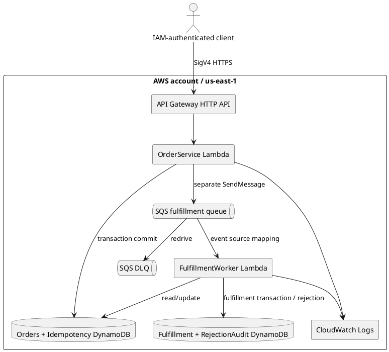

# Well-Architected Review: SilentLoss baseline — Reliability pillar

> **Classification: CONFIDENTIAL** — This report contains sensitive infrastructure details and unremediated findings. Restrict distribution to authorized personnel.

## Coverage Audit
- **Review status:** COMPLETE — 63 of 63 in-scope Reliability BPs read in full, assessed, and spot-checked.
- **Run:** 20261126T100328Z-a91f; started 2026-11-26T10:03:28Z. Every count covers this run only.
- **Review Integrity:** no embedded instructions found in inspected workload material.
- **Review mode:** Reliability pillar-scoped, 63 of 261 BPs in the live Framework index. No other pillar was assessed in this run.
- **BP pages read:** 63 / 63 in scope; 13 / 13 Reliability questions; 17 / 17 shards.
- **Unreadable BP pages:** none (cap 4).
- **Read proof:** 63 rows record matching total_length and end_index, truncated false, and opening and tail quotes; mcp_read 63, web_fetch 0; unverified rows 0. Read proof is agent-checked, not machine-verified.
- **Spot-check:** 10 fixed-sample pages re-read, 10 passed, 0 shards redone. It confirms sampled quotes, not every row.
- **Framework source:** [AWS Well-Architected live table of contents](https://docs.aws.amazon.com/wellarchitected/latest/framework/toc-contents.json), retrieved through AWS MCP on 2026-11-26. The index includes Cloud Foundations and six Cloud Workloads pillars: 57 questions and 261 BPs. The Reliability scope contains 13 questions and 63 BPs.
- **Status distribution:** Implemented 2; Partially Implemented 33; Not Implemented 7; Not Applicable 5; Cannot Determine 16.
- **Evidence ledger:** [aws-well-architected-review-ledger](/silentloss//aws-well-architected-review-ledger/index.md) — 17 shard files, 63 BP rows and spot-check.md. Workload evidence was read from the repository and historical deployment reports; no AWS account was queried live in this run.

## Executive Summary
- **Date:** 26 November 2026
- **Workload:** SilentLoss baseline, a serverless order processing benchmark in us-east-1.
- **Business criticality:** Standard experimental workload; committed-order correctness is its key outcome.
- **Lens applied:** General Framework, Reliability pillar.
- **Packages analyzed:** SAM template, Lambda handlers, reconciliation and benchmark code, tests, deployment and resource inventory reports.
- **Questions assessed:** 13 / 13 Reliability questions.
- **Findings:** 0 Critical, 2 High, 9 Medium, 0 Low.
- **Overall maturity:** **2 / 5.** The baseline has strong idempotency, managed services, a DLQ and bounded smoke tests. The database-to-SQS handoff can strand a committed order, and no continuous alarm detects that business outcome. The score reflects this experimental baseline, not an independently observed live incident.

## Architecture Overview

The order and idempotency record are written atomically. SQS publication happens afterward, creating the principal reliability gap. The worker processes SQS messages with duplicate protection and partial batch failure handling. The Phase 3 report documents normal-path smoke success; it does not establish behavior under the planned publication fault.

## Pillar Scorecard

| Reliability category | Score (1–5) | BPs assessed | Strength | Main gap |
| --- | ---: | ---: | --- | --- |
| REL01 Quotas | 2 | 6/6 | Worker concurrency accounts for known quota | No quota alarms or complete inventory |
| REL02 Network topology | 3 | 2/2 | Managed API endpoint | Connectivity recovery untested |
| REL03 Service architecture | 3 | 3/3 | Order and fulfillment functions separated | No versioned machine-readable contract |
| REL04 Distributed interactions: prevent failures | 2 | 4/4 | Idempotent writes and duplicate suppression | Non-atomic DynamoDB-to-SQS handoff |
| REL05 Distributed interactions: withstand failures | 2 | 7/7 | SQS DLQ and bounded worker | No DLQ alarm; failed send can strand an order |
| REL06 Monitoring | 1 | 7/7 | Structured logs and offline reconciliation | No continuous outcome alarms |
| REL07 Demand adaptation | 2 | 4/4 | Managed elastic services | No measured peak headroom |
| REL08 Change | 2 | 5/5 | SAM and extensive tests | No blocking deployment pipeline or rollback alarm |
| REL09 Backup | 2 | 5/5 | Data sources identified | Recovery choice and RPO undefined; PITR off |
| REL10 Fault isolation | 3 | 3/3 | Managed regional services | Location tolerance not stated |
| REL11 Component failure | 2 | 7/7 | Managed replacement and SQS retry | Application-level stranding has no healing or alert |
| REL12 Reliability testing | 2 | 5/5 | Fault adapter and benchmark protocol exist | Fault experiment and sustained load test pending |
| REL13 Disaster recovery | 2 | 5/5 | Infrastructure reproducible as SAM | RTO/RPO and recovery strategy undefined |

## Per-Question Assessment

| ID | Question | Status | Risk | Key Evidence |
| --- | --- | --- | --- | --- |
| REL01 | Manage service quotas and constraints | Partially Implemented | Medium | 2 PI, 2 NI, 1 NA, 1 CD; worst REL01-BP04 |
| REL02 | Plan your network topology | Partially Implemented | Medium | 1 PI, 1 NA; worst REL02-BP01 |
| REL03 | Design your workload service architecture | Partially Implemented | Medium | 1 I, 2 PI; worst REL03-BP01 |
| REL04 | Design interactions in a distributed system to prevent failures | Partially Implemented | High | 3 PI, 1 CD; worst REL04-BP01 |
| REL05 | Design interactions in a distributed system to mitigate or withstand failures | Partially Implemented | High | 1 I, 5 PI, 1 CD; worst REL05-BP01 |
| REL06 | Monitor workload resources | Partially Implemented | High | 4 PI, 2 NI, 1 CD; worst REL06-BP03 |
| REL07 | Design your workload to adapt to changes in demand | Partially Implemented | Medium | 4 PI; worst REL07-BP04 |
| REL08 | Implement change | Partially Implemented | Medium | 4 PI, 1 NI; worst REL08-BP03 |
| REL09 | Back up data | Partially Implemented | Medium | 1 PI, 1 NI, 3 CD; worst REL09-BP03 |
| REL10 | Use fault isolation to protect your workload | Partially Implemented | Medium | 1 PI, 2 NA; worst REL10-BP01 |
| REL11 | Design your workload to withstand component failures | Partially Implemented | High | 3 PI, 1 NI, 3 CD; worst REL11-BP01 |
| REL12 | Test reliability | Partially Implemented | Medium | 2 PI, 3 CD; worst REL12-BP03 |
| REL13 | Plan for Disaster Recovery (DR) | Partially Implemented | Medium | 1 PI, 1 NA, 3 CD; worst REL13-BP01 |

## BP Ledger (compact: every in-scope BP)

| BP ID | Status | Risk |
| --- | --- | --- |
| REL01-BP01 | Partially Implemented | Medium |
| REL01-BP02 | Not Applicable | - |
| REL01-BP03 | Partially Implemented | Medium |
| REL01-BP04 | Not Implemented | Medium |
| REL01-BP05 | Not Implemented | Medium |
| REL01-BP06 | Cannot Determine | - |
| REL02-BP01 | Partially Implemented | Medium |
| REL02-BP02 | Not Applicable | - |
| REL03-BP01 | Partially Implemented | Medium |
| REL03-BP02 | Implemented | - |
| REL03-BP03 | Partially Implemented | Medium |
| REL04-BP01 | Partially Implemented | High |
| REL04-BP02 | Partially Implemented | High |
| REL04-BP03 | Cannot Determine | - |
| REL04-BP04 | Partially Implemented | Medium |
| REL05-BP01 | Partially Implemented | High |
| REL05-BP02 | Partially Implemented | Medium |
| REL05-BP03 | Partially Implemented | Medium |
| REL05-BP04 | Partially Implemented | High |
| REL05-BP05 | Partially Implemented | Medium |
| REL05-BP06 | Implemented | - |
| REL05-BP07 | Cannot Determine | - |
| REL06-BP01 | Partially Implemented | High |
| REL06-BP02 | Partially Implemented | Medium |
| REL06-BP03 | Not Implemented | High |
| REL06-BP04 | Not Implemented | High |
| REL06-BP05 | Partially Implemented | Medium |
| REL06-BP06 | Cannot Determine | - |
| REL06-BP07 | Partially Implemented | Medium |
| REL07-BP01 | Partially Implemented | Medium |
| REL07-BP02 | Partially Implemented | Medium |
| REL07-BP03 | Partially Implemented | Medium |
| REL07-BP04 | Partially Implemented | Medium |
| REL08-BP01 | Partially Implemented | Medium |
| REL08-BP02 | Partially Implemented | Medium |
| REL08-BP03 | Not Implemented | Medium |
| REL08-BP04 | Partially Implemented | Medium |
| REL08-BP05 | Partially Implemented | Medium |
| REL09-BP01 | Partially Implemented | Medium |
| REL09-BP02 | Cannot Determine | - |
| REL09-BP03 | Not Implemented | Medium |
| REL09-BP04 | Cannot Determine | - |
| REL09-BP05 | Cannot Determine | - |
| REL10-BP01 | Partially Implemented | Medium |
| REL10-BP02 | Not Applicable | - |
| REL10-BP03 | Not Applicable | - |
| REL11-BP01 | Partially Implemented | High |
| REL11-BP02 | Partially Implemented | Medium |
| REL11-BP03 | Partially Implemented | High |
| REL11-BP04 | Cannot Determine | - |
| REL11-BP05 | Cannot Determine | - |
| REL11-BP06 | Not Implemented | High |
| REL11-BP07 | Cannot Determine | - |
| REL12-BP01 | Cannot Determine | - |
| REL12-BP02 | Cannot Determine | - |
| REL12-BP03 | Partially Implemented | Medium |
| REL12-BP04 | Partially Implemented | Medium |
| REL12-BP05 | Cannot Determine | - |
| REL13-BP01 | Partially Implemented | Medium |
| REL13-BP02 | Cannot Determine | - |
| REL13-BP03 | Cannot Determine | - |
| REL13-BP04 | Not Applicable | - |
| REL13-BP05 | Cannot Determine | - |

Evidence ledger: [aws-well-architected-review-ledger](/silentloss//aws-well-architected-review-ledger/index.md) — each row's page quote, read proof, evidence, rationale and recommendation is in its shard file.

## Critical and High Risk Findings

### F1 — High: committed orders can lose their fulfillment trigger

**BPs:** REL04-BP01, REL04-BP02, REL05-BP01, REL11-BP03. AWS's REL04-BP02 outcome calls for components to interact through “published interfaces or durable intermediaries.” In [order_service.py](/silentloss//src/lambdas/handlers/order_service.py:324), the order and idempotency record commit before the separate SQS send at line 469. On a rejected send, line 530 returns an explicit error, but no durable dispatch intent or replay path exists. Idempotent replay prevents duplicate order creation without restoring publication.

**Impact Severe, Likelihood Medium → High.** A committed order may never reach fulfillment; the Phase 3 normal-path smoke tests do not measure this fault. **Recommendation:** preserve the baseline for the controlled experiment, then make the dispatch intent durable in the same commit boundary, publish from that intent, and reconcile until each committed order is fulfilled, recoverably pending, or explicitly failed. **Effort:** 1–4 weeks. **Services:** DynamoDB, Streams or equivalent outbox, Lambda, SQS.

### F2 — High: business outcome failures lack an alarm and response path

**BPs:** REL06-BP01, REL06-BP03, REL06-BP04, REL05-BP04, REL11-BP01, REL11-BP06. REL06-BP01 requires monitoring that includes “business-outcome metrics.” The SAM [template.yaml](/silentloss//template.yaml:243) defines log groups and an SQS DLQ, while its resource list defines no CloudWatch alarm, metric filter, or notification target. Reconciliation is run offline. A failed publication or growing DLQ can therefore remain unnoticed by operators.

**Impact Moderate, Likelihood High → High.** Detection depends on manual inspection. **Recommendation:** publish commit-to-fulfillment lag and unaccounted-order counts; alarm on publication failures, oldest queue message, DLQ depth, Lambda errors and throttles; route each alarm to an owner with a tested response. **Effort:** under a week for initial alarms, then tune after fault tests. **Services:** CloudWatch, SQS, Lambda, SNS or another approved notification route.

## Medium Risk Findings

| ID | BPs | Evidence and BP outcome | Impact / Likelihood | Recommendation |
| --- | --- | --- | --- | --- |
| F3 — Retry and timeout proof | REL04-BP04, REL05-BP02, REL05-BP03, REL05-BP05 | REL04-BP04 says clients should “safely retry after a timeout.” Conditional writes and SQS retries exist, but [order_service.py](/silentloss//src/lambdas/handlers/order_service.py:251) replay does not repair a missing send; the remote evidence client uses 0.2/0.4-second timeouts at [aws_acquisition.py](/silentloss//src/reconciliation/aws_acquisition.py:46). | Moderate / Medium | Test every ambiguous result and retry budget; use measured remote client timeouts. |
| F4 — Recovery choices | REL09-BP01, REL09-BP03, REL13-BP01 | REL09-BP01 asks whether each source is backed up or reproduced. All four DynamoDB tables disable PITR in [template.yaml](/silentloss//template.yaml:79); no RPO/RTO is stated for synthetic records. | Moderate / Medium | Classify each table, state RPO/RTO, and enable/test backups only where required. |
| F5 — Quota headroom | REL01-BP01, REL01-BP03, REL01-BP04, REL01-BP05 | REL01-BP04 expects alerts with time to request a quota increase. The account's Lambda concurrency 10 is recorded and worker concurrency capped at 2, but no quota alarm exists in [template.yaml](/silentloss//template.yaml:274). | Moderate / Medium | Inventory service quotas and alarm before headroom is exhausted. |
| F6 — Deeper observability | REL06-BP02, REL06-BP05, REL06-BP07 | REL06-BP02 calls for aggregate metrics representing workload behavior. Structured logs and offline summaries exist; the [template](/silentloss//template.yaml:243) has no metric filters or X-Ray configuration. | Moderate / Medium | Add aggregate outcome metrics, trace propagation, and a log review cadence. |
| F7 — Deployment controls | REL08-BP01, REL08-BP02, REL08-BP03, REL08-BP04, REL08-BP05 | REL08-BP02 expects tests on every change in the deployment pipeline. The [Phase 3 report](/silentloss//PHASE_3_DEPLOYMENT_REPORT.md:19) records strong manual gates, but no blocking pipeline, staged rollout or rollback alarm. | Moderate / Medium | Put existing tests and SAM validation into a pipeline; add staged release and rollback. |
| F8 — Peak capacity | REL07-BP01, REL07-BP02, REL07-BP03, REL07-BP04, REL12-BP03 | REL07-BP04 asks which component fails first under load. The [Phase 3 report](/silentloss//PHASE_3_DEPLOYMENT_REPORT.md:64) describes bounded smoke tests at concurrency 2, without a measured breaking point. | Moderate / Medium | Define peak demand and run representative sustained load tests. |
| F9 — Fault experiment | REL12-BP04 | REL12-BP04 asks to verify resilience through fault injection. The isolated adapter exists in [template.yaml](/silentloss//template.yaml:22), but the Phase 3 deployment kept it disabled and did not execute the publication fault. | Moderate / Medium | Run the planned bounded fault experiment and preserve raw evidence. |
| F10 — Service contract | REL03-BP01, REL03-BP03 | REL03-BP03 expects producer and consumer changes to honor a common contract. Routes are in [template.yaml](/silentloss//template.yaml:190) and handlers validate events, but no versioned machine-readable contract is present. | Moderate / Medium | Publish OpenAPI and a versioned order event schema. |
| F11 — Location recovery | REL11-BP02, REL10-BP01, REL02-BP01 | REL10-BP01 says location strategy should match resilience requirements. Managed regional services are used, but the [resource inventory](/silentloss//AWS_RESOURCE_INVENTORY.md:1) documents one Region and no accepted outage duration or connectivity test. | Moderate / Medium | State accepted Region outage/RTO, then test endpoint and component recovery; add Regions only if targets require them. |

## Low Risk Findings

None. The lowest assessed gap risk in this run was Medium.

## Cross-Pillar Trade-offs

Only Reliability BPs were assessed. The main cost trade-off is conditional: enabling PITR, alarms, traces, staged deployments, or cross-Region recovery increases spend. REL09-BP01 and REL13-BP01 support choosing backup and recovery measures from the synthetic workload's stated RPO/RTO; REL10-BP01 calls for a location strategy that matches requirements. This avoids adding costly resilience components without a measured need.

## Prioritize Improvements — Eisenhower Matrix

| Quadrant | Action | Findings |
| --- | --- | --- |
| **Do First** — high importance, lower effort | Establish visibility and explicit recovery requirements | F2, F4, F5, F9 |
| **Plan** — high importance, higher effort | Close the publication boundary and productionize controls | F1, F3, F7, F8, F10 |
| **Delegate** — lower importance, lower effort | Improve diagnostic depth | F6 |
| **Defer** — lower immediate importance, higher effort | Revisit location architecture after objectives are set | F11 |

### Solution characteristics

The durable dispatch change should be a two-way door: retain the baseline stack and benchmark harness, implement the new publisher as a separable path, then compare both under the same controlled fault. Use versioned IaC and code review. Set owners for alarms and recovery decisions; automation should replay only when duplicate business effects remain prevented.

## Prioritized Remediation Plan

### Quick wins (< 1 week) — Do First

| Finding | SMART goal | Suggested owner | Effort |
| --- | --- | --- | --- |
| F2 | Within five working days, define four business and queue health signals, add alarm thresholds and recipients in a reviewable change, and demonstrate that a controlled failure reaches the owner. | Workload owner / operations | 2–4 days |
| F4 | Within three working days, classify all four DynamoDB tables as disposable, reproducible, or protected; record RPO/RTO and a backup decision for each. | Workload owner | 1–2 days |
| F5 | Within five working days, record relevant quotas and peak assumptions, then add at least one alarm for Lambda concurrency headroom. | Workload owner / platform | 2–3 days |
| F9 | In the next isolated benchmark window, run the documented publication fault scenario with a fixed sample and preserve raw response and reconciliation evidence. | Benchmark owner | 1–3 days |

### Foundation (1–4 weeks) — Plan

| Finding | Action and measurable acceptance | Phases | Effort | Dependency |
| --- | --- | --- | --- | --- |
| F1 | Commit a durable dispatch intent with each order; under the same bounded fault, every committed order must be fulfilled, recoverably pending, or explicitly failed, with zero unaccounted orders and no duplicate business effect. | Design; implement isolated path; fault benchmark; compare and review | 1–4 weeks | F9 baseline evidence; idempotency invariant |
| F3 | Exercise ambiguous send, duplicate delivery, retry exhaustion, and remote timeout paths; record observed attempts and outcomes. | Test matrix; tune budgets; rerun | 1–2 weeks | F1 design |
| F7 | Run the existing test suite and SAM validation on every proposed deployment, block on failure, then test staged rollout and rollback. | Pipeline; smoke gate; rollout/rollback | 2–4 weeks | F2 alarm signals |
| F8 | Define a representative peak and sustain it long enough to identify the first limiting service and safe throughput. | Targets; test; adjust caps | 1–2 weeks | Quota inventory |
| F10 | Version the HTTP and event contracts and verify producers/consumers against them in tests. | Schema; compatibility tests | 1–2 weeks | F1 event design |

### Strategic (1–3 months) — Plan

No additional strategic change is justified by this temporary baseline. Revisit multi-Region or a richer recovery architecture only if F4 establishes an RTO/RPO that the existing regional services cannot meet.

### Delegate

| Finding | Action | Suggested owner | Effort |
| --- | --- | --- | --- |
| F6 | Add aggregate CloudWatch metrics, trace context, and a weekly query review; measure time to locate a failed order. | Observability owner | 2–5 days |

### Deferred — Revisit next iteration

F11: decide whether an additional location or endpoint failover path is needed after the workload's accepted outage and data-loss tolerance are recorded. The current experimental benchmark has no stated multi-Region requirement.

## Next Steps

1. Approve the baseline fault experiment's exact sample, failure mode, and stop conditions; preserve its raw evidence.
2. Define the four tables' recovery classification and the benchmark's RTO/RPO.
3. Add reviewable alarms for publication failure, unaccounted-order lag, DLQ depth, and Lambda errors.
4. Design and test the durable publication path without altering the baseline comparison.
5. Run the same benchmark against both paths and report unaccounted orders, duplicate effects, recovery time, and cost.
